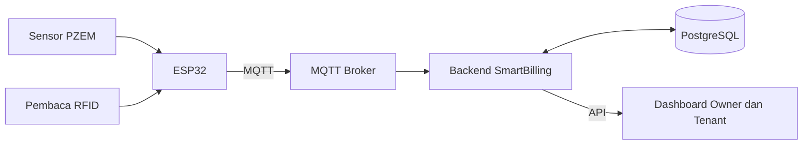

# SmartBilling — Capstone A05

SmartBilling adalah aplikasi web berbasis Internet of Things (IoT) untuk memantau konsumsi listrik dan mengelola pembagian tagihan pada kost yang menggunakan meter listrik bersama. Pemilik kost dapat melihat penggunaan listrik setiap kamar dan fasilitas bersama, sedangkan penghuni dapat memantau pemakaian serta rincian tagihan miliknya.

Aplikasi ini dikembangkan sebagai proyek Capstone A05 untuk mendukung pengelolaan listrik kost yang lebih transparan dan pembagian biaya berdasarkan data pemakaian.

## Pengguna

| Pengguna | Akses utama |
| --- | --- |
| **Owner / pemilik kost** | Mengelola kamar, penghuni, perangkat dan tarif; memantau konsumsi; menyusun tagihan; mencatat pembayaran dan pembelian token; serta melihat laporan. |
| **Tenant / penghuni** | Memantau konsumsi kamar, melihat riwayat penggunaan fasilitas bersama, serta mengakses tagihan final dan status pembayaran miliknya. |

## Fitur utama

- **Monitoring listrik:** menampilkan tegangan, arus, daya, energi kumulatif, dan waktu pembacaan terakhir dari meter yang terpasang.
- **Histori dan perbandingan konsumsi:** grafik serta ringkasan energi berdasarkan rentang tanggal untuk memahami pola penggunaan listrik.
- **Tagihan per kamar dan penghuni:** pengelolaan periode, tarif, perhitungan tagihan, finalisasi, dan koreksi dengan rincian biaya yang dapat dilihat penghuni.
- **Pencatatan pembayaran:** owner dapat menandai tagihan sebagai lunas dan melihat tagihan yang belum dibayar.
- **Token dan tagihan bulanan:** pencatatan pembelian token listrik serta perbandingan total pembelian dengan tagihan final tenant, termasuk ringkasan lunas, belum dibayar, dan selisih nominal.
- **Sesi fasilitas bersama berbasis RFID:** tap pertama memulai sesi penggunaan, lalu tap berikutnya dengan kartu yang sama mengakhirinya. Data sesi menjadi dasar alokasi penggunaan fasilitas kepada penghuni.
- **Administrasi kost:** pengelolaan properti, kamar, masa tinggal penghuni, kartu RFID, fasilitas, perangkat, dan pemasangan meter.
- **Kesehatan perangkat:** informasi kiriman data terakhir, keterlambatan pembacaan, jeda data, dan masalah kualitas pengukuran.
- **Laporan dan ekspor CSV:** ringkasan konsumsi, tagihan, pembayaran, dan perbandingan antar kamar untuk kebutuhan pelaporan owner.

## Cara kerja

Sensor PZEM membaca parameter listrik, kemudian ESP32 mengirimkan hasil pengukuran melalui MQTT. Backend memvalidasi dan menyimpan data ke PostgreSQL, menghitung konsumsi serta biaya, lalu menyediakan hasilnya melalui API untuk dashboard.

Dashboard memperbarui pembacaan secara berkala. Akses setiap pengguna dibatasi sesuai properti dan masa tinggal yang terkait dengan akunnya.

## Pengolahan konsumsi dan tagihan

- Konsumsi listrik dihitung dari selisih pembacaan energi kumulatif yang valid pada suatu rentang waktu.
- Perhitungan energi dan biaya dilakukan di backend agar dashboard menampilkan hasil perhitungan yang konsisten.
- Data yang belum tersedia atau tidak lengkap ditampilkan sesuai kondisinya, tanpa dianggap sebagai konsumsi nol.
- Preview dan data simulasi dibedakan dari pengukuran perangkat serta tagihan final. Tenant melihat tagihan final yang menjadi bagiannya.
- Histori pembacaan disimpan untuk penelusuran dan perbandingan konsumsi antarwaktu.

## Teknologi

| Bagian | Teknologi |
| --- | --- |
| Frontend | React, Vite, Recharts, CSS |
| Backend | JavaScript, Node.js, Express |
| Database | PostgreSQL |
| Komunikasi perangkat | MQTT, MQTT.js, Eclipse Mosquitto |
| Perangkat IoT | ESP32-C3, sensor PZEM, pembaca RFID |
| Lingkungan pengembangan | Docker Compose |

## Dokumentasi

Panduan pemasangan, konfigurasi perangkat, dan penggunaan lingkungan pengembangan tersedia pada dokumentasi berikut:

- [Panduan pengembangan lokal](docs/LOCAL-DEVELOPMENT.md)
- [Kebutuhan produk](docs/PRD.md)
- [Arsitektur sistem](docs/ARCHITECTURE.md)
- [Rancangan database](docs/database/cpstn-erd-final.md)
- [Kontrak komunikasi ESP32](docs/ESP32-MQTT-CONTRACT.md)
- [Panduan billing](docs/FRONTEND-BILLING.md)
