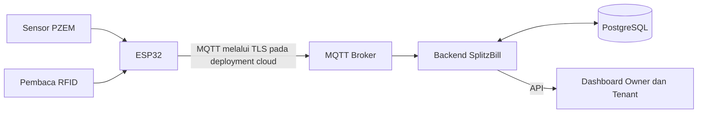

# SplitzBill — Capstone A05

SplitzBill adalah aplikasi web berbasis Internet of Things (IoT) untuk memantau konsumsi listrik dan mengelola pembagian tagihan pada kost yang menggunakan meter listrik bersama. Pemilik kost dapat melihat penggunaan listrik setiap kamar dan fasilitas bersama, sedangkan penghuni dapat memantau pemakaian serta rincian tagihan miliknya.

Aplikasi ini dikembangkan sebagai proyek Capstone A05 untuk mendukung pengelolaan listrik kost yang lebih transparan dan pembagian biaya berdasarkan data pemakaian.

[Buka aplikasi SplitzBill](https://splitzbilla05.up.railway.app).

Repository ini memuat source aplikasi, firmware ESP32, migration database, pengujian, dan dokumentasi teknis. Akun, kredensial perangkat, serta data pengamatan PostgreSQL disiapkan secara terpisah.

## Pengguna

| Pengguna | Akses utama |
| --- | --- |
| **Owner / pemilik kost** | Mengelola kamar, penghuni, perangkat dan tarif; memantau konsumsi; menyusun tagihan; mencatat pembayaran dan pembelian token; serta melihat laporan. |
| **Tenant / penghuni** | Memantau konsumsi kamar, melihat riwayat penggunaan fasilitas bersama, serta mengakses tagihan final dan status pembayaran miliknya. |
| **Pengunjung expo** | Melihat semua halaman owner dalam mode hanya baca melalui akun terpisah yang dapat kedaluwarsa atau dicabut. Persiapan: [akun pengunjung](docs/EXPO-VISITOR.md). |

## Fitur utama

- **Monitoring listrik:** menampilkan tegangan, arus, daya, energi kumulatif, dan waktu pembacaan terakhir dari meter yang terpasang.
- **Histori dan perbandingan konsumsi:** grafik serta ringkasan energi berdasarkan rentang tanggal untuk memahami pola penggunaan listrik.
- **Tagihan per kamar dan penghuni:** pengelolaan periode, tarif, perhitungan tagihan, finalisasi, dan koreksi dengan rincian biaya yang dapat dilihat penghuni.
- **Pencatatan pembayaran:** owner dapat menandai tagihan sebagai lunas dan melihat tagihan yang belum dibayar.
- **Token dan tagihan bulanan:** pencatatan pembelian token listrik serta perbandingan total pembelian dengan tagihan final tenant, termasuk ringkasan lunas, belum dibayar, dan selisih nominal.
- **Sesi fasilitas bersama berbasis RFID:** tap pertama memulai sesi penggunaan, lalu tap berikutnya dengan kartu yang sama mengakhirinya. Data sesi menjadi dasar alokasi penggunaan fasilitas kepada penghuni.
- **Administrasi kost:** pengelolaan properti, kamar, masa tinggal penghuni, kartu RFID, fasilitas, perangkat, dan pemasangan meter.
- **Kesehatan perangkat:** informasi kiriman data terakhir, keterlambatan pembacaan, jeda data, dan masalah kualitas pengukuran.
- **Kontrol relay kamar:** owner dapat meminta ON/OFF pada perangkat yang sudah dipetakan dan diverifikasi. Hasil menunggu konfirmasi perangkat; riwayat ditampilkan tiga baris per halaman, terbaru dahulu.
- **Keamanan sesi:** akses dibatasi menurut peran dan properti. Semua akun keluar setelah 15 menit tanpa aktivitas pengguna, dengan batas sesi maksimal delapan jam.
- **Laporan dan ekspor CSV:** ringkasan konsumsi, tagihan, pembayaran, dan perbandingan antar kamar untuk kebutuhan pelaporan owner.

## Cara kerja

Sensor PZEM membaca parameter listrik, kemudian ESP32 mengirimkan hasil pengukuran melalui MQTT. Backend memvalidasi dan menyimpan data ke PostgreSQL, menghitung konsumsi serta biaya, lalu menyediakan hasilnya melalui API untuk dashboard.



Dashboard memperbarui pembacaan secara berkala. Akses setiap pengguna dibatasi sesuai properti dan masa tinggal yang terkait dengan akunnya. PostgreSQL menyimpan histori aplikasi; histori tidak bergantung pada log console hosting.

## Pengolahan konsumsi dan tagihan

- Konsumsi listrik dihitung dari selisih pembacaan energi kumulatif yang valid pada suatu rentang waktu.
- Perhitungan energi dan biaya dilakukan di backend agar dashboard menampilkan hasil perhitungan yang konsisten.
- Data yang belum tersedia atau tidak lengkap ditampilkan sesuai kondisinya, tanpa dianggap sebagai konsumsi nol.
- Preview dan data simulasi dibedakan dari pengukuran perangkat serta tagihan final. Tenant melihat tagihan final yang menjadi bagiannya.
- Histori pembacaan disimpan untuk penelusuran dan perbandingan konsumsi antarwaktu.
- Tujuh hari merupakan target pengamatan proyek, bukan aturan penghapusan data otomatis.

## Teknologi

| Bagian | Teknologi |
| --- | --- |
| Frontend | React, Vite, Recharts, CSS |
| Backend | JavaScript, Node.js, Express |
| Database | PostgreSQL |
| Komunikasi perangkat | MQTT, MQTT.js, Eclipse Mosquitto |
| Perangkat IoT | ESP32-C3, sensor PZEM, pembaca RFID |
| Lingkungan pengembangan | Docker Compose |
| Deployment | Railway |

## Struktur repository

| Lokasi | Isi |
| --- | --- |
| `src/` | API Express, autentikasi, penerimaan MQTT, sesi RFID, dan perhitungan tagihan |
| `web/` | Dashboard React, grafik, formulir, dan tampilan laporan |
| `firmware/` | Sketch dan header ESP32 untuk meter, relay, serta RFID |
| `migrations/` | Perubahan skema PostgreSQL yang dijalankan berurutan |
| `test/` | Pengujian backend dan integrasi; pengujian frontend juga ada di `web/` |
| `scripts/` | Utilitas pengembangan, konfigurasi, provisioning, dan verifikasi |
| `docs/` | Panduan teknis, kontrak data, serta rancangan sistem dan database |

## Firmware ESP32

| Fungsi perangkat | Source utama |
| --- | --- |
| Monitoring Kamar 1 dan meter utama | [pzem-dashboard](firmware/pzem-dashboard/pzem-dashboard.ino) |
| Monitoring dan kontrol relay Kamar 2 | [pzem-relay-trial](firmware/pzem-relay-trial/pzem-relay-trial.ino) |
| RFID dan pencatatan sesi fasilitas | [rfid-pzem-v42-sesi](firmware/rfid-pzem-v42-sesi/rfid-pzem-v42-sesi.ino) |

Setiap sketch memerlukan file header dalam foldernya. Baca README firmware, salin `secrets.example.h` menjadi `secrets.h`, lalu isi konfigurasi perangkat pada berkas lokal tersebut. Koneksi cloud memerlukan konfigurasi TLS dan CA yang sesuai. Source yang sama dapat dipakai pada perangkat berbeda dengan identitas serta konfigurasi masing-masing.

## Menjalankan lingkungan lokal

Prasyarat: Node.js 22 atau lebih baru, npm, serta Docker Compose dengan Docker Engine aktif. Perintah berikut untuk instalasi pengembangan baru, dijalankan dari root repository:

```powershell
npm ci
npm run init:local
node scripts/init-auth-local.js
docker compose build
docker compose up -d postgres mqtt
docker compose run --rm --no-deps backend npm run migrate
docker compose up -d backend
```

Buka `http://127.0.0.1:3000`. Database baru belum memiliki akun dan pemetaan perangkat; konfigurasi akun/data master dilakukan secara terpisah. Tidak ada seed atau simulator yang dijalankan otomatis. Lingkungan expo existing dapat menggunakan port 3001 dengan konfigurasi Compose tersendiri.

Untuk konfigurasi Windows, akun pengembangan, simulator, dan lingkungan existing, ikuti [panduan lokal](docs/LOCAL-DEVELOPMENT.md). Gunakan panduan lingkungan yang sesuai sebelum menjalankan perintah pada instalasi yang sudah berisi data.

## Pemeriksaan kode

```powershell
npm run check
npm test
npm run build
```

Sebagian tes integrasi memerlukan PostgreSQL dan konfigurasi pengujian tersendiri; tes tersebut dapat dilewati pada pengujian host tanpa database. Pengujian perangkat fisik dilakukan terpisah dari pengujian software.

## Konfigurasi dan data

- `.env.example` dan `secrets.example.h` berisi contoh konfigurasi. `.env`, `secrets.h`, dan `.local/` merupakan berkas lokal yang tidak disertakan dalam source control.
- Git menyimpan source dan migration, bukan isi database. Backup PostgreSQL dan pemulihannya dilakukan secara terpisah dari commit/push kode.
- Deployment Railway menggunakan layanan backend, PostgreSQL, dan broker MQTT. Konfigurasi, urutan deployment, serta TLS perangkat dijelaskan pada [panduan Railway](docs/RAILWAY-DEPLOYMENT.md).

## Dokumentasi

Panduan pemasangan, konfigurasi perangkat, dan penggunaan lingkungan pengembangan tersedia pada dokumentasi berikut:

- [Panduan pengembangan lokal](docs/LOCAL-DEVELOPMENT.md)
- [Kebutuhan produk](docs/PRD.md)
- [Arsitektur sistem](docs/ARCHITECTURE.md)
- [Rancangan database](docs/database/cpstn-erd-final.md)
- [Kontrak komunikasi ESP32](docs/ESP32-MQTT-CONTRACT.md)
- [API monitoring](docs/API-MONITORING.md)
- [Konfigurasi Wi-Fi ESP32](docs/PZEM-WIFI-SETUP.md)
- [Kontrol relay kamar](docs/ROOM-RELAY-CONTROL.md)
- [Sesi login](docs/AUTH-SESSIONS.md)
- [Panduan billing](docs/FRONTEND-BILLING.md)
- [Pembagian konsumsi bersama](docs/SHARED-BILLING.md)
